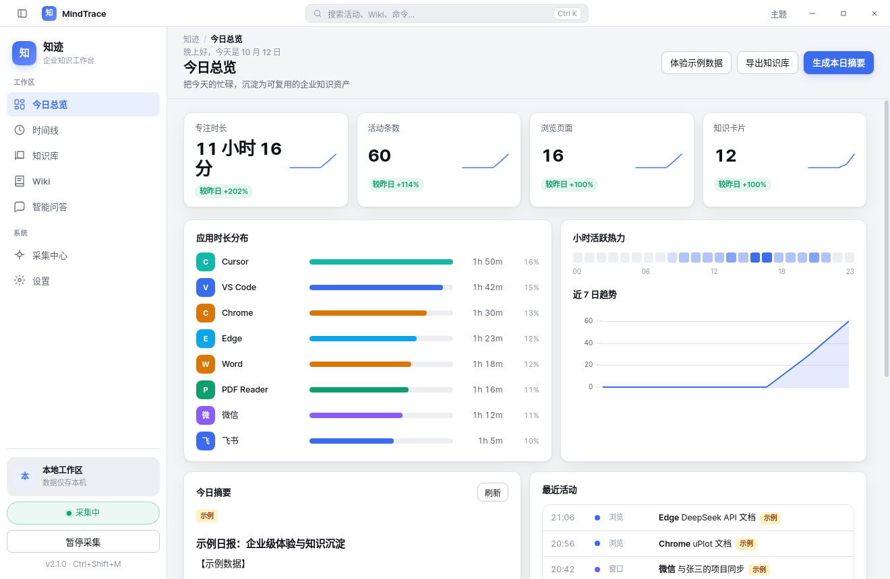
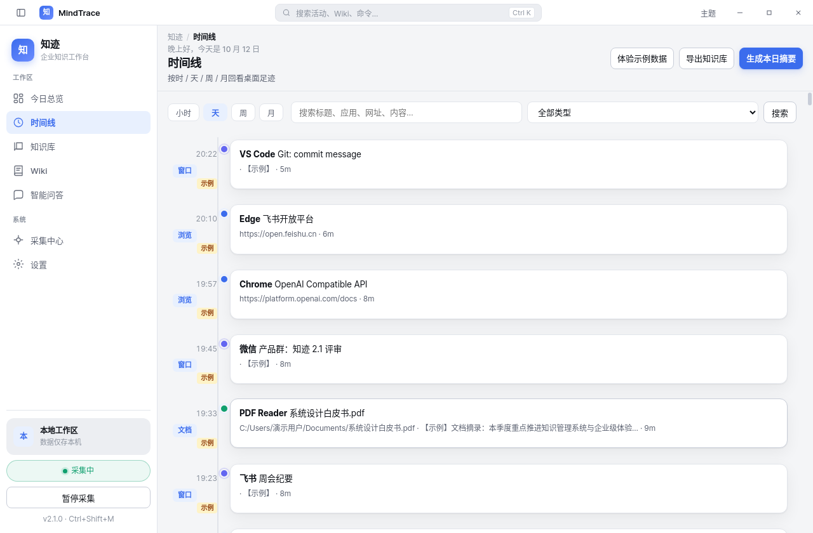
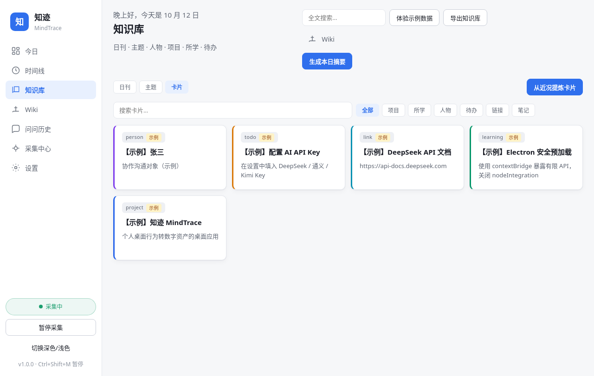

# 知迹 MindTrace 2.3

把每天散落在浏览器、IDE、文档、下载、截屏和各个窗口里的操作，**经你授权后**整理成可复用的个人数字资产，并沉淀为 **LLM 维护的 Wiki + 记忆库**。

- **本地优先**：数据默认只存在本机 `userData`
- **分项授权**：窗口 / 浏览器 / IDE / 笔记 / 下载 / 最近文件 / UI Automation / 剪贴板 / 截屏识图 —— **默认全部关闭**
- **不卡顿架构**：采集走低优先级 Worker（事件总线 + 批处理 + CPU/电量预算），目标平均 CPU <3%、内存 <300MB
- **时间线缩放**：小时 / 天 / 周 / 月 汇总卷
- **知识库 · 记忆 · 日历（2.3）**：电脑上发生的一切 → 带引用的实体页、关于你的记忆、计划 vs 实际的日历；一个「待处理」中心统一确认
- **LLM Wiki**：时间卷 · 实体页 · 记忆条目，可导出 Obsidian
- **可被其他 AI 使用**：本机 HTTP API + MCP Server（`api.port+1`）
- **企业级界面**：自定义标题栏、可折叠侧栏、Ctrl+K 命令面板、KPI/图表、双主题
- **体验示例数据**：无需真实采集即可预览完整界面

> 不是监控软件。不做密码键盘记录，不破解微信数据库，不默认上传云端。详见下方「明确不做」。

设计文档：[`../mindtrace-design/UNIFIED-2.3.md`](../mindtrace-design/UNIFIED-2.3.md)（2.3 总体架构） · [`../mindtrace-design/PRD-2.0.md`](../mindtrace-design/PRD-2.0.md) · [`../mindtrace-design/DESIGN-SYSTEM-2.md`](../mindtrace-design/DESIGN-SYSTEM-2.md) · [`../mindtrace-design/DESIGN.md`](../mindtrace-design/DESIGN.md)

---

## 下载

当前 GitHub 上**没有**已发布的安装包（无 Release）。README 旧文曾写 `MindTrace-2.1.0-*.exe`，但发行页不存在这些资产，请勿当作可下载链接。`package.json` 版本为 **2.4.9**；打包命令为 `npm run build:win`（产物通常落在本地 `dist/`）。本轮因磁盘空间不足未重新打包、未上传。

请从源码运行，或由维护者在有足够磁盘的环境打包后发布。

## 界面截图

以下为仓库 `screenshots/` 中已有的真实产品界面（含示例数据演示），不是生成图。



*今日总览 / Today's overview*



*时间线 / Timeline*



*知识库 / Knowledge*

更多见 `screenshots/`（引导页、深色主题、聊天等）。

### 从源码运行

```bash
npm install
npm start
# 开发模式
npm run dev
```

打包：

```bash
npm run build:win
```

---

## 2.0 新能力一览

| 能力 | 说明 |
|------|------|
| Worker 采集架构 | `src/worker/`：EventBus 批处理、Budget 背压、感知哈希去重；采集器经 host 调度 |
| 时间线缩放 | 小时/天/周/月 rollup；Wiki 引擎增量生成时间卷 |
| Wiki + 记忆 | 实体页（人/项目/主题/工具/站点）+ 记忆条目；Obsidian 镜像导出 |
| 快速笔记 | 全局热键唤起 Markdown 笔记窗（标签）；可监视 Obsidian/导出/md 目录 |
| IDE 采集 | VS Code / Cursor / JetBrains：最近工程、git 当日提交、终端历史、本地可读的 chat 日志 → 日摘要 |
| 下载 / 打开文件 | Downloads 监视 + pdf/docx/xlsx/pptx/epub/md/html 文本抽取；Recent / Office MRU |
| 截屏管道 | 感知哈希跳过未变/空闲；本地 OCR 优先（Windows.Media.Ocr / 可选 tesseract），再 LLM 抽取有用信息 |
| UI Automation | 前台窗口无障碍树文本（节流），+ 窗口标题 |
| FTS5 全文检索 | 活动/笔记/抽取文本可搜 |
| MCP Server | 默认 `api.port + 1`，工具发现与读写 Wiki/记忆/时间线 |

---

## 2.2 专业版能力

| 能力 | 说明 |
|---|---|
| 隐私规则引擎 | 按应用/网站设置「不采集 / 仅标题 / 完整」；自动识别密码管理器、网银、无痕窗口、登录页；全部拦截写入 **审计日志** |
| 按时间范围清除 | 采集中心一键清除最近 15 分钟 / 1 小时 / 24 小时或自定义区间 |
| 仅本地模式 | 开启后只允许调用 127.0.0.1 上的模型（如 Ollama） |
| 加密备份 | `.mtbak` 单文件，AES-256-GCM + scrypt；口令错误时不改动现有数据 |
| 记忆审核 | 低于置信阈值的记忆进入「待审」，通过后才对问答与 MCP 可见 |
| 用量与预算 | 按模型统计 Tokens / 费用 / 耗时 / 失败率；月度预算超限自动停用 |
| 任务队列 | 摘要、汇总卷作为任务入队，失败可重试 |
| 洞察 | 深度工作分、专注会话（≥25 分钟）、上下文切换、AFK、应用/项目分配、本周回顾 |
| 标准 MCP | JSON-RPC 2.0（`initialize` / `tools/list` / `tools/call`），设置页提供 Cursor / Claude Desktop 配置 |
| 诊断包 | 导出版本、采集器状态、表规模与日志，密钥已脱敏 |

### 2.2 交互升级（根据 UX 走查）

- 导航按 **记录 / 知识 / 助手** 分组，「记忆」单独成为入口；`Ctrl+1…7` 切换页面
- 页头按钮随页面变化；设置页按分区放进页签；采集中心合并为一张表，开关即时生效并自动保存
- Ctrl+K 命令中枢：`>` 执行操作，`@` 查人物和项目，`#` 查主题，`?` 直接问 AI；方向键选择，回车执行
- 时间轴密度条：悬停查看时段摘要，拖动框选后可「问这段时间」
- Wiki 中的 `[[双链]]` 悬停弹出实体卡片；问答引用点开后在侧滑面板溯源，可一键「不再采集此来源」
- 总览顶部有设置进度清单；提示条区分成功、失败、信息三类，并支持撤销

设计与竞品对标见 `mindtrace-design/PRD-2.2.md`，UX 走查见 `mindtrace-design/UX-AUDIT.md`。

## 2.3：知识库 · 记忆 · 日历（统一架构）

一条流水线，三个产物，一个确认中心。总体设计与决策记录见 `../mindtrace-design/UNIFIED-2.3.md`。

```
活动 → 资料(documents，URL 去 utm/hash 归一) → 资料块(chunks，observed_at / privacy_level)
     → 统一抽取（每 ≤8 块一次调用；无 AI 时用本地规则）
     → 知识库：实体（别名 / 拼音 / 编辑距离匹配，≥2 次目击转正）→ 事实（证据 + 冲突）→ 实体页（引用 · 我的笔记 · 修订 · log.md）
     → 记忆：偏好 / 习惯 / 技能 / 关系 / 个人事实 / 决策（置信 · 衰减 · 强化 · 取代 · 锁定）
     → 日历：会议 / 待办 / 截止 / 提醒（默认「建议」，跨来源合并，改期变成建议）+ 实际活动块 + 会议识别
     → 待处理：记忆审核 · 日程建议 · 改期 · 实体合并 · 事实冲突
```

| 页面 | 快捷键 | 说明 |
|------|--------|------|
| 今日总览 | Ctrl+1 | 新增「计划 vs 实际」双轨条、今日日程、今日新知、记忆与待处理 |
| 知识库 | Ctrl+3 | 实体列表（拼音搜索）· 实体页（脚注引用可点击定位）· 事实与证据 · 修订历史 · 变更日志 · **我的笔记**（AI 永不修改）· 遗忘 |
| 记忆 | Ctrl+4 | 生效 / 待审核 / 已取代 / 已归档 / 已驳回；置信与强度条；证据与历史；编辑即锁定；置顶；导出 JSON；「关于我」档案 |
| 日历 | Ctrl+8 | 日 / 周 / 月 / 议程；计划轨与实际轨对照；中文快速添加（「明天下午3点 和李四评审」「每周一上午10点 周会」）；AI 建议；导出 ICS / 订阅链接 |
| 待处理 | Ctrl+9 | 全部 AI 产出在此确认；「不再提示」写入墓碑 |

关键规则：

- **人工编辑优先**：编辑过的记忆、确认过的事实、修改过的日程字段都会锁定，AI 不再覆盖；「我的笔记」区块逐字保留。
- **证据优先**：每条事实 / 记忆 / AI 日程都在统一 `evidence` 表里关联到资料块与原始活动；实体页事实 100% 带脚注。
- **隐私**：只采到窗口标题的内容（`privacy_level=title`）不进入资料块、AI、记忆与日历；敏感内容（证件号、卡号、密码、验证码等）被拦截并记审计；`遗忘某人/某项目` 会级联删除知识库、记忆、日历中的相关内容并写墓碑，可选同时删除原始活动；按时间段删除会级联删除只来自该时段的派生内容。
- **衰减**：统一半衰期表（项目 30 天、人物 60 天、偏好 180 天、决策不衰减…）；实体页超过半衰期 1.5 倍标记「可能过时」，记忆强度过低自动归档（置顶除外）。
- **预算**：每日 token 预算（默认 20 万）按 抽取 60% / 编译 25% / 汇总 15% 分配；超出后自动回落到本地规则抽取。
- **中文时间解析** `src/calendar/zhtime.js`：相对日期、星期、上下午、「三点一刻」、区间「2-4点」、「周五前」、重复规则、2026 国庆调休、PT/ET 时区。
- **提醒**：Windows 系统通知 + 应用内横幅（稍后 10 分钟）。
- **ICS**：设置中开启本机 API 后，`GET http://127.0.0.1:17321/calendar/feed.ics?token=<订阅令牌>` 可被 Outlook / 手机日历订阅（错误令牌返回 401）。

存储引擎：2.3 起使用 **better-sqlite3 11.10（WAL + 真 FTS5）**，Windows x64 预编译 `.node`（Electron 33 / ABI 130）位于安装目录 `resources/app.asar.unpacked/native/win32-x64/`；加载失败时自动回落 sql.js + FTS4，再回落 bigram LIKE。中文检索在写入与查询两侧做 bigram 预分词。FTS 写入错误不再被吞掉，计数可在「诊断」中查看。

---

## 首次授权（必读）

首次启动会进入 **4 步引导**，不可跳过授权说明：

1. **欢迎** — 了解知迹做什么  
2. **选择采集项** — **默认全部关闭**；请主动勾选需要的项  
3. **配置 AI** — 可稍后配置  
4. **完成** — 可选开机自启 / 进入后开始采集  

随时可在 **采集中心** 开关单项、查看采集器状态，或用 `Ctrl+Shift+M` / 托盘菜单 **一键暂停**。

关闭主窗口不会退出，应用会留在系统托盘。

---

## 配置 AI 模型（推荐）

路径：**设置 → OpenAI 兼容接口**

| 预设 | Base URL（参考） | 推荐模型 |
|------|------------------|----------|
| DeepSeek | `https://api.deepseek.com/v1` | `deepseek-flash`（或 `deepseek-v4-pro`；填模型 ID，不是显示名） |
| 通义千问 | `https://dashscope.aliyuncs.com/compatible-mode/v1` | `qwen-plus` |
| Kimi | `https://api.moonshot.cn/v1` | `moonshot-v1-8k` |
| OpenAI | `https://api.openai.com/v1` | `gpt-4o-mini` |
| Ollama 本地 | `http://127.0.0.1:11434/v1` | 如 `llama3.2` |
| 自定义 | 任意兼容网关 | 自定 |

建议：

1. 填入 API Key 后点 **测试连接**  
2. 温度建议 `0.2–0.4`（结构化摘要更稳）  
3. 若要用截屏识图 / OCR，务必填写支持图像输入的 **视觉模型**（如 `gpt-4o`、`qwen-vl-plus`、`llava`）。纯文本模型不能看图；**视觉模型可留空**——截屏仍会本地保存，只是跳过识图  
4. 本地 Ollama 可不填 Key；识图请用 `llava` / `qwen2-vl` 等视觉模型  

功能入口：

- 今日页 **生成本日摘要** → 日刊 + 卡片增量  
- 知识库 **从近况抽取卡片** / 主题聚类  
- **Wiki** → 生成/浏览时间卷与实体页、记忆  
- **问问历史** → 自然语言检索（回答带引用芯片）

开发者可用内置 Mock：

```bash
node scripts/mock-openai-server.js 3921
# 设置 Base URL = http://127.0.0.1:3921/v1 ，Key 任意
```

---

## 导出到 Obsidian

点击顶栏 **导出知识库**，选择目录后生成（2.0 含 Wiki 镜像）：

```
MindTraceVault/
├── 00-首页.md
├── 日刊/
├── 主题/
├── 卡片/
├── wiki/          # 时间卷 · 实体 · 记忆
│   ├── time/
│   ├── entity/
│   └── memory/
└── raw/export.json
```

---

## 本地 API + MCP

默认 **关闭**。在 **设置** 中启用 API 后监听 `127.0.0.1:17321`；MCP 同主机 `17322`（`port+1`）。

Header：`Authorization: Bearer <Token>`

| 方法 | 路径 | 说明 |
|------|------|------|
| GET | `/health` | 健康检查（含 version） |
| GET | `/stats/today` | 今日统计 |
| GET | `/activities?q=&type=&limit=` | 时间线 / FTS |
| GET | `/cards?kind=` | 知识卡片 |
| GET | `/journals` | 日刊列表 |
| GET | `/journals/:day` | 单日日刊 |
| GET | `/topics` | 主题 |
| POST | `/ask` | `{"question":"..."}` |
| POST | `/summarize` | 触发生成日刊 |
| POST | `/extract-cards` | 抽取卡片 |
| POST | `/cluster-topics` | 主题聚类 |
| GET | `/mcp/tools` | 工具清单（轻量发现） |

### MCP（标准 JSON-RPC 2.0，端口 17322）

端点 `POST http://127.0.0.1:17322/mcp`，方法 `initialize`、`tools/list`、`tools/call`、`ping`。工具：`search`、`get_timeline`、`get_wiki_page`、`list_wiki_pages`、`get_memories`（仅已审核）、`get_rollups`、`get_analytics`、`add_note`；2.3 新增 `get_profile`（关于我 + 进行中的承诺，不含私密）、`recall`（按 token 预算召回记忆/情景/承诺，档案 ≤40%）、`get_episodes`、`remember`（写入后进入待处理）、`get_calendar`、`add_calendar_item`（进入待处理）、`complete_calendar_item`、`forget_subject`（仅发起请求，需在应用内确认）。旧接口 `GET /mcp/tools`、`POST /mcp/call` 仍然保留。

Cursor（`~/.cursor/mcp.json`）：

```json
{ "mcpServers": { "mindtrace": { "url": "http://127.0.0.1:17322/mcp", "headers": { "Authorization": "Bearer <token>" } } } }
```

Claude Desktop：

```json
{ "mcpServers": { "mindtrace": { "command": "npx", "args": ["-y", "mcp-remote", "http://127.0.0.1:17322/mcp", "--header", "Authorization:Bearer <token>"] } } }
```

```bash
curl -s http://127.0.0.1:17322/mcp -H "Authorization: Bearer <token>" -H "Content-Type: application/json" \
  -d '{"jsonrpc":"2.0","id":1,"method":"tools/call","params":{"name":"search","arguments":{"query":"发布"}}}'
```

```bash
curl -s http://127.0.0.1:17321/health -H "Authorization: Bearer <token>"
```

---

## 隐私与「明确不做」

1. **未授权不采集**；每项默关  
2. 数据仅在本机；调用云端 AI 时才会发送你触发摘要/问答所需的上下文  
3. 应用 / 网站 / 关键词 **黑名单**；剪贴板 **自动脱敏**  
4. **不会记录知迹自身窗口**；应用名友好显示  
5. 截屏可限封闭应用；空闲不截；约保留 14 天截屏 / 90 天活动  
6. **不做**：密码/支付字段键盘记录；解密微信/聊天软件私有库；无提示的远控上报；绕过 OS 权限的内核注入  

---

## 界面说明

| 导航 | 内容 |
|------|------|
| 今日 | 专注时长、浏览页数、摘要、应用分布、最近活动 |
| 时间线 | **小时/天/周/月** 缩放 + 类型检索 |
| 日历 | 日/周/月/议程，计划 vs 实际 |
| 知识库 | 实体页（引用 · 我的笔记 · 修订） |
| 记忆 | 关于我：证据 · 衰减 · 锁定 |
| 待处理 | 统一确认 AI 产出 |
| 报告 | 日刊 / 主题 / 卡片 |
| Wiki | 时间卷 |
| 问问历史 | 建议问题；示例模式下预置带引用问答 |
| 采集中心 | 开关（含 IDE/笔记/下载/UIA 等）、状态、黑名单、示例数据 |
| 设置 | AI、本机 API、关于 |

支持浅色 / 深色主题。快速笔记：全局热键（见设置/采集中心说明）。

---

## 性能预算

| 指标 | 目标 |
|------|------|
| 平均 CPU | < 3%（空闲/节流后） |
| 内存 | < 300MB 常驻（含 sql.js 库） |
| 入库批处理 | EventBus 合并写入；背压时降频 |
| 截屏 | 感知哈希跳过未变化帧 |
| UIA | 前台窗口节流采样 |

本地库使用 **better-sqlite3（WAL）+ FTS5**，sql.js + FTS4 作为回落。1 万条事件写入约 0.5 秒，归一化 + 分块约 0.3 秒；1 万条记忆 recall < 50ms；3000 条日程月视图 < 300ms。高强度采集可缩短保留天数。

---

## 开发与测试

```bash
# Mock OpenAI
node scripts/mock-openai-server.js 3921

# AI / API / FTS / rollup / 记忆 等自动化
./node_modules/.bin/electron scripts/e2e-ai-test.js --no-sandbox

# 性能：模拟 1 万条事件
./node_modules/.bin/electron scripts/e2e-perf-10k.js --no-sandbox

# 2.3 验收：KB-01..16 / 记忆 1..12 / 日历 T13..T20 / MCP / 遗忘（需 mock :3921 运行 KB-14）
./node_modules/.bin/electron tests/v23-acceptance.js --no-sandbox
MINDTRACE_SQLJS=1 ./node_modules/.bin/electron tests/v23-acceptance.js --no-sandbox   # sql.js 回落路径

# 中文时间解析（日历 T1..T12，T10 农历除外）
node tests/zhtime.test.js

# 截图巡游
npm run shots
```

---

## 常见问题

**Q: 安装后提示无法运行？**  
A: 允许 SmartScreen「仍要运行」；或改用 portable / zip。

**Q: Chrome 历史读不到？**  
A: 知迹会 **复制 History 文件再读**。请授权「浏览器历史」，并至少用过 Chrome/Edge。多配置档会自动扫描。

**Q: 微信为什么没有聊天记录？**  
A: **不破解微信数据库**。请开启截屏 + 视觉模型，由 OCR/识图生成描述。

**Q: 为什么会卡？**  
A: 检查是否同时开了多项重采集；Worker 会按预算降频。可关 UIA/截屏，或缩短保留天数。

**Q: 数据在哪？如何清除？**  
A: `%APPDATA%/知迹 MindTrace/`。卸载时可选保留用户数据。

---

## 路线图摘要

- **已交付（2.1.0）**：Worker 总线与预算、时间线缩放与 rollup、Wiki/记忆、快速笔记、IDE/下载/最近文件/UIA 采集器骨架、截屏 phash、FTS、MCP、e2e + 10k 性能测试  
- **已交付（2.3.0）**：better-sqlite3 + FTS5 + 中文 bigram；统一抽取流水线；知识库实体页（引用 / 我的笔记 / 修订 / log.md）；记忆 2.0；日历（计划 vs 实际、会议识别、提醒、ICS 订阅）；待处理中心；跨三域遗忘；8 个新 MCP 工具
- **后续（P1）**：向量检索 + RRF 融合、Obsidian 回读、LLM 增量补丁式编译、合并撤销 UI、关系图谱、农历、外部日历同步 / CalDAV、AI 日计划、Windows 通知按钮（toast actions）、`utilityProcess` 隔离、WinRT OCR  

## 许可证

MIT

---

## English

**MindTrace (知迹) 2.4.9** — a local-first personal digital-asset workbench. Collect (only after you opt in) browser / IDE / docs / downloads / window activity into a timeline, Wiki, and memory store. Not spyware: no keylogging, no default cloud upload.

### Download

There is **no** published installer on GitHub Releases. Older README text mentioning `MindTrace-2.1.0-*.exe` does not correspond to any current release asset. Package with `npm run build:win` when disk allows. This pass did not build or upload packages.

### Screenshots

The images above are existing real UI captures under `screenshots/` (including sample-data demos). They are not generated artwork.

### Run from source

```bash
npm install
npm start
# or
npm run dev
```
